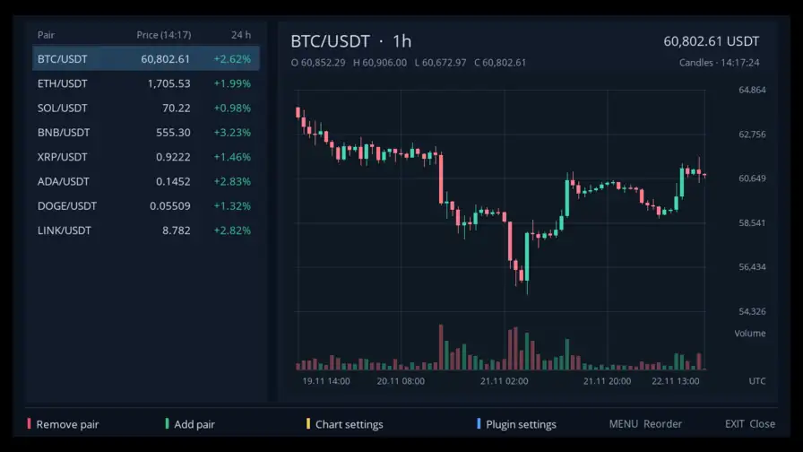

# Crypto Market for Enigma2

Crypto Market is an Enigma2 plugin for compatible OE-Alliance images. It tracks cryptocurrency prices, 24-hour changes, and trading volume with candlestick charts and a customizable watchlist.

<p align="center">
  <a href="docs/dashboard.webp"></a>
</p>

## Installation

Open a terminal session on the receiver and run the following command to install or update Crypto Market.

```sh
opkg install https://github.com/Haehnchen/enigma2-plugin-development/releases/latest/download/enigma2-plugin-extensions-cryptomarket.ipk
```

If you already copied the IPK to the receiver, run `opkg install /path/to/package.ipk` instead. Restart the Enigma2 GUI after installation.

## Controls

Open **Extensions → Crypto Market**. Use `↑` and `↓` to move through the watchlist.

| Key | Action |
| --- | --- |
| `F1` (Red) | Remove a pair. |
| `F2` (Green) | Add a pair. |
| `F3` (Yellow) or `Enter` | Change the current chart interval and candle count. |
| `F4` (Blue) | Save chart defaults for the next launch. |
| `Space` (Menu) | Move the selected pair up or down. |

## Market data

Prices and charts use Binance Spot. USDT and USDC pairs are ranked by CoinGecko market cap (60%) and Binance 24-hour turnover (40%).

## Storage

The watchlist and chart defaults are saved in `/etc/enigma2/crypto-market.json` on a receiver or in the `crypto-market` Compose volume.

## Development

- `make test` runs the Python unit tests.
- `make test-picker` checks the pair picker in an OpenATV container.
- `make dist` writes the IPK to `../dist/`. Set the base version in [package.control](package.control).
