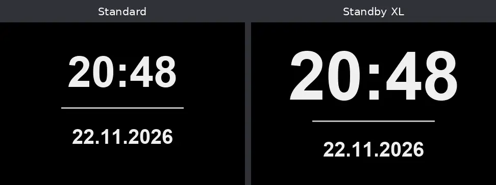

# Standby XL

Large standby clock and compact date for 480 × 320 front displays.



## Installation

Run this command in a terminal on the receiver to install or update Standby XL from the latest release.

```sh
opkg install https://github.com/Haehnchen/enigma2-plugin-development/releases/latest/download/enigma2-plugin-extensions-standby-xl.ipk
```

For a local build, copy the IPK to `/tmp/` on the receiver and run `opkg install /tmp/enigma2-plugin-extensions-standby-xl_*.ipk`.

Select **Standby XL** under **Skin Settings → LCD/Front panel**.

## Development

- `make preview` regenerates the comparison and the skin selector preview.
- `make test` checks skin selection and the rendered standby layout.
- `make dist` builds the IPK in `../dist/`.
