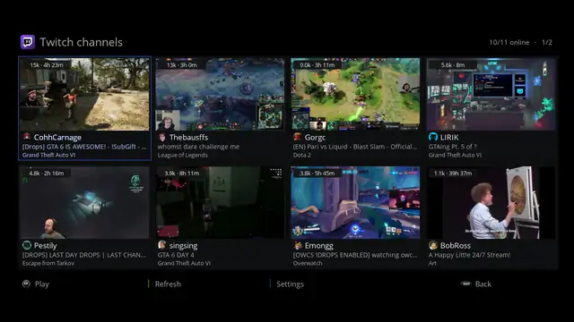
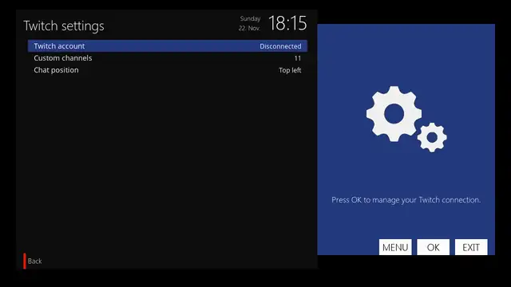
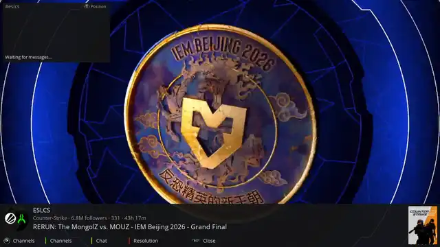
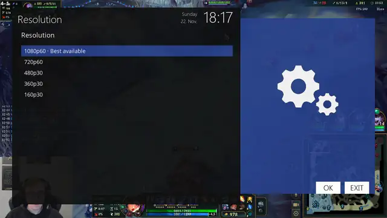

# Twitch Player

Twitch Player is an Enigma2 plugin for watching live Twitch streams via Streamlink.

<p>
  <a href="docs/channels.webp"></a>
</p>

## Installation

Open a terminal session on the receiver and run the following command to install or update Twitch Player.

```sh
opkg install https://github.com/Haehnchen/enigma2-plugin-development/releases/latest/download/enigma2-plugin-extensions-twitchplayer.ipk
```

To install a local build, copy the IPK to the receiver and run `opkg install /path/to/package.ipk`. Restart the Enigma2 GUI, then open **Extensions → Twitch Player**.

## Features

- Live channel grid with previews, stream titles, categories, viewer counts and time live.
- Custom channels added by name.
- Twitch account linking via device code to show followed channels.
- Video resolution selection during playback.
- Chat overlay with Twitch emotes, colored usernames and eight screen positions.

<p>
  <a href="docs/settings.webp"></a>
</p>

<p>
  <a href="docs/chat.webp"></a>
  <a href="docs/resolution.webp"></a>
</p>

## Build from source

Run these commands from the repository root.

```sh
cd plugin-twitch-player
make test
make dist
```

The IPK is written to `../dist/`. The base version is set in [package.control](package.control).
